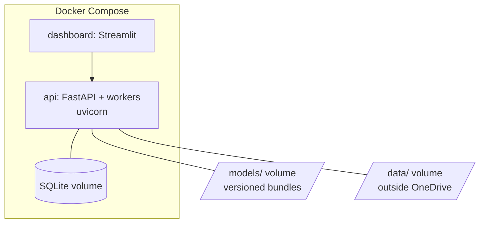

# SYSTEM_ARCHITECTURE — DSCI-41

Status: **PROPOSED v0.1 — 2026-11-23, awaiting approval.** Decisions marked ADR-n are recorded in §9.

---

## 1. Design principles

1. **One pipeline, two configurations.** O2 and O3 run the *same* code path; O3 differs only by the `robustness:` config
   block. That makes AC-4 (frozen resource envelope) and ablations mechanical rather than manual.
2. **Every number carries its provenance.** Each result record stores: dataset manifest ID, partition, config hash,
   model-bundle hash, code commit, resource-envelope ID, and a `reliability` flag (`OK` / `DEGRADED` / `ABSTAIN`).
3. **Fail loudly.** The envelope monitor runs alongside inference; a result outside the validated envelope is labelled,
   never silently returned as normal (FR-7, NT-1…NT-5).
4. **Observed vs. estimated vs. predicted are different types.** `ReferenceCount` (human ground truth),
   `EstimatedCount` (pipeline output), `Forecast` (model prediction). They cannot be mixed in charts or metrics without
   an explicit conversion, and the dashboard colours/labels them differently. Demo data uses a fourth type, `DemoSample`.
5. **CPU-first, accelerator-optional.** Every stage runs on CPU; OpenVINO (Intel iGPU/NPU) or CUDA are optional backends
   selected by config.

## 2. End-to-end data flow

```mermaid
flowchart LR
    V[Roadside video<br/>MP4/AVI/frames] --> ING[Ingestion &<br/>validation]
    ING -->|Frame, VideoMeta| ENV{Envelope<br/>monitor}
    ING --> ENH[O3 robustness<br/>pre-processing<br/>(optional, gated)]
    ENH --> DET[Detection<br/>YOLO]
    DET -->|Detection[]| TRK[Tracking<br/>ByteTrack]
    TRK -->|Track[]| GEO[Perspective<br/>homography]
    GEO --> CNT[Counting<br/>line / zone, direction, class]
    CNT -->|EstimatedCount per interval| FEAT[Feature<br/>extraction]
    FEAT --> FC[Congestion<br/>forecasting]
    ENV -.->|reliability flags| CNT
    ENV -.->|reliability flags| FC
    CNT --> DB[(SQLite<br/>results store)]
    FC --> DB
    DB --> API[FastAPI]
    API --> UI[Streamlit<br/>dashboard]
    DB --> EVAL[Evaluation &<br/>acceptance harness]
    REF[(Reference counts<br/>& annotations)] --> EVAL
```

## 3. Component responsibilities and contracts

| Module | Input → Output | Key responsibilities | Errors raised |
|--------|----------------|----------------------|---------------|
| `src/ingestion` | path/upload → `VideoMeta`, frame iterator | Container/codec probe (OpenCV + `ffprobe`), fps/resolution/duration/frame-count checks, corrupt-frame scan, frame stride, manifest lookup | `UnsupportedVideoError`, `CorruptVideoError`, `UnregisteredEvidenceError` |
| `src/enhancement` (O3) | `Frame`, `ConditionEstimate` → `Frame` | Condition estimation (luminance, contrast, blur, rain score); gated low-light enhancement; rain/noise suppression; logs which operators fired | `EnhancementError` |
| `src/detection` | `Frame` → `list[Detection]` | Model loading (PyTorch / OpenVINO), confidence & NMS thresholds, class map to project taxonomy | `ModelBundleError` |
| `src/classification` | `Detection` → project class | Map detector classes → {car, motorcycle, bus, truck, bicycle?, other}; per-dataset class mapping tables; no class claimed that the model/dataset does not support | — |
| `src/tracking` | `list[Detection]` per frame → `list[Track]` | ByteTrack (two-stage association incl. low-score boxes), track buffer, trajectories; O3 options: ground-plane motion gating, tracklet stitching | — |
| `src/perspective` | calibration file → `Homography` | Per-camera image↔ground-plane mapping from ≥ 4 point correspondences, reprojection error check, ROI/line definitions in ground coordinates, calibration snapshot for drift detection | `CalibrationError` |
| `src/counting` | `list[Track]`, lines/zones → `EstimatedCount` events | Line-crossing and zone-based counting, direction from ground-plane motion, per-class, per-camera, duplicate-count prevention (one count per track ID per line, min track length, hysteresis) | — |
| `src/forecasting` | count time series → `Forecast` | Feature engineering, baselines, RF/XGBoost, horizon-wise evaluation, congestion level mapping | `InsufficientHistoryError` |
| `src/evaluation` | results + references → metrics/reports | Detection (P/R/mAP50/mAP50-95), tracking (IDF1/MOTA/IDSW), counting (MAE/RMSE/WAPE/accuracy, bootstrap CI), forecasting (MAE/RMSE per horizon), latency (p50/p95/p99), KPI-1…KPI-6, envelope comparison | `EnvelopeMismatchError` |
| `src/monitoring` | per-frame stats → `ReliabilityFlag` | Envelope monitor shared by runtime and negative tests | — |
| `src/api` | HTTP ↔ services | FastAPI: upload, jobs, results, forecasts, metrics, health; Pydantic schemas; background job runner | HTTP 4xx/5xx with typed error body |
| `dashboard/` | API → UI | Streamlit multipage, Plotly; never reads files directly, only via API | — |

Core data types (`src/common/types.py`, Pydantic/dataclasses): `VideoMeta`, `Frame`, `Detection`, `Track`,
`CountEvent`, `IntervalCount` (`source: reference|estimated|demo`), `Forecast`, `ReliabilityFlag`, `RunRecord`.

## 4. O2 reference — two candidate approaches (PDF requires ≥ 2 with a documented trade-off)

| | O2-A: image-space counting | O2-B: perspective-aware counting |
|---|---|---|
| Detector | Same COCO-pretrained YOLO (nano/small), optionally fine-tuned on the development partition | Same |
| Tracker | ByteTrack, default parameters | ByteTrack, default parameters |
| Counting | Virtual line in pixel coordinates, direction from pixel motion | Homography to ground plane; counting line/zone defined in metres; direction from ground-plane velocity; scale-aware min-size filter |
| Pros | No calibration; simple | Robust to oblique view (far-field small vehicles, line placement independent of perspective foreshortening); enables speed/density estimates |
| Cons | Line placement sensitive to perspective; far vehicles small | Needs per-camera calibration (NT-3 risk) |

Both are measured under AC-1 and AC-4; the one chosen becomes **the** O2 reference and its KPI values are frozen.
This comparison is also the PDF's requested "with and without perspective handling" analysis.

## 5. O3 contribution — candidate components (each ablatable)

| Component | Target condition | Approach | Cost |
|-----------|------------------|----------|------|
| C-gate: condition estimator | all | Cheap per-frame statistics (mean/percentile luminance, RMS contrast, Laplacian variance, rain-streak score) → condition label; drives gating so enhancement only runs when needed (protects KPI-6) | ~1 ms |
| C-lowlight | night | CLAHE on luminance + adaptive gamma; optional learned light-weight enhancer (e.g. Zero-DCE-style) if measured to help | 1–10 ms |
| C-rain | rain | Temporal median/min filtering over short windows for static-camera streak removal; light denoise | 2–8 ms |
| C-detector | all adverse | Fine-tune detector on **development partition only** with photometric/weather augmentation (darkening, noise, synthetic rain, blur) | training cost only |
| C-occlusion-track | dense occlusion | ByteTrack with tuned low-score association + longer buffer, ground-plane Kalman/motion gating, tracklet stitching before counting | small |
| C-calib | detector confidence | Per-condition confidence threshold selected on development data (never on AC-3) | none at runtime |

O3 evaluation = full ablation matrix (O2, O2+each component, O3 full, O3 minus each component) on the identical
evidence and resource envelope, with bootstrap CIs and condition-wise breakdowns. A component is retained only if its
measured contribution is positive within the CI or justified by a measured resource gain.

## 6. Forecasting subsystem

- **Input:** `IntervalCount` series (estimated) per camera, direction, class; interval length configurable (default
  proposal 1 min, aggregation to 5/15 min).
- **Features:** lagged counts, rolling mean/std, class mix (heavy-vehicle share), occupancy/density proxy (vehicles in ROI
  per frame), ground-plane speed **only when calibration passes** (flagged `estimated`), time-of-day/day-of-week **only
  when real timestamps exist**, reliability flags of inputs.
- **Models:** persistence and seasonal-naive baselines (mandatory comparators), Random Forest, XGBoost; direct
  multi-horizon strategy (one model per horizon).
- **Congestion level:** the Barbados dataset provides real 4-class congestion ratings (free flowing / light / moderate /
  heavy delay) per ~1-min segment, with a 5-minute-ahead protocol. Those labels are the forecasting target on Barbados.
  On data without labels, a **derived** level from
  volume/density with thresholds fitted on the development partition, stored in config, and labelled "derived proxy"
  in every output and report. No speed or congestion label is ever invented.
- **Validation:** rolling-origin backtest inside development data; acceptance on the reserved partition only.
- **Uncertainty:** empirical prediction intervals from development residuals (quantile), shown only if calibration
  (coverage) is verified.

## 7. Evidence and partition design

```
data/raw/<dataset>/<version>/...          immutable, checksummed, never edited
data/manifests/<dataset>.yaml             source URL, access date, licence, custodian, item IDs, SHA-256, exclusions
data/manifests/partitions.yaml            item → {dev_train, dev_val, acceptance_AC3}, split unit = camera/site
data/manifests/partitions.lock            hash of partitions.yaml, created BEFORE O3 tuning
data/processed/<dataset>/<transform_id>/  derived data; transform_id = hash(code, config, inputs)
data/annotations/                         converted annotations (COCO / MOT formats) + converter version
```

- Split unit: **camera/site** first, then condition stratification; temporal adjacency between splits is forbidden.
- AC-3 partition contents are not readable by training/tuning scripts (loader checks the lock and the caller's role).
- Any fitted statistic (normaliser, enhancement parameter, threshold, forecaster scaler) records the IDs it was fitted on;
  NT-5 fails if any acceptance ID appears.

## 8. Deployment view



- Local dev: `uv` Python 3.11 venv; `uvicorn src.api.main:app` + `streamlit run dashboard/Home.py`.
- Clean rebuild: `docker compose build && docker compose run api python scripts/reproduce_all.py`.
- PostgreSQL only if concurrent multi-camera ingestion is demonstrated to need it (ADR-6).

## 9. Architecture decision records (proposed)

| ADR | Decision | Alternatives | Rationale |
|-----|----------|--------------|-----------|
| ADR-1 | **Signed python.org Python 3.11.9** (via `py install`) + stdlib `venv` outside OneDrive; `uv` only resolves/installs from `uv.lock` | System Python 3.15; uv-managed CPython 3.11.17 | Spec asks 3.11; widest wheel support. uv's unsigned venv launcher was **blocked by Smart App Control** (CodeIntegrity events 3033/3077, 2026-11-23); the PSF-signed build is not |
| ADR-2 | Ultralytics YOLO (nano/small) as detector | RT-DETR, YOLOX (Apache-2.0), torchvision Faster R-CNN | Best speed/accuracy on CPU, OpenVINO export, built-in training; **licence is AGPL-3.0** → repo must be AGPL-compatible if distributed (R-09) |
| ADR-3 | ByteTrack via **Ultralytics `BYTETracker`** (+ `lap`) | `supervision` (dropped its tracker in 0.32), OC-SORT, BoT-SORT, DeepSORT | Spec-preferred; low-score association helps occlusion; no ReID model → CPU-friendly; no extra licence beyond ADR-2 |
| ADR-4 | OpenVINO as optional CPU/iGPU accelerator | CUDA (not available), ONNX Runtime | Hardware is Intel Core Ultra with Arc iGPU + NPU, no NVIDIA |
| ADR-5 | Streamlit + Plotly UI talking only to FastAPI | Streamlit calling Python directly | Clean interface contract, testable API, FR-4/FR-5 contracts |
| ADR-6 | SQLite results store | PostgreSQL | Single-node prototype; switch only when concurrency is shown to require it |
| ADR-7 | Data stored outside OneDrive (configurable `DATA_ROOT`) | Inside project folder | 11.6 GB free disk and OneDrive sync of large binaries |

## 10. Repository layout (proposed)

```
CapstoneProject/                       (to be its own git repo — see RISK R-15)
├── docs/UseCase.pdf
├── data/{raw,processed,annotations,samples,manifests}/   (only manifests + tiny samples tracked)
├── models/{detection,tracking,forecasting}/              (bundle metadata tracked; weights via DATA_ROOT)
├── configs/        base.yaml, o2_a.yaml, o2_b.yaml, o3.yaml, resource_envelope.yaml, cameras/<cam>.yaml, kpi.yaml
├── src/
│   ├── common/         types, config loading, logging, provenance
│   ├── ingestion/  enhancement/  detection/  classification/  tracking/
│   ├── perspective/  counting/  forecasting/  monitoring/  evaluation/
│   ├── datasets/       loaders + annotation converters per dataset
│   └── api/
├── dashboard/      Home.py + pages/1_Overview.py … 8_System_Monitoring.py, theme.css
├── scripts/        download_subset.py, build_manifest.py, run_o2_reference.py, run_o3.py,
│                   train_forecaster.py, run_acceptance.py, benchmark_latency.py, reproduce_all.py
├── tests/{unit,integration,acceptance,negative}/
├── reports/        o2/, o3/, ablations/, negative_tests/, acceptance/, final/
├── notebooks/      exploration only — never the source of a reported number
├── pyproject.toml, requirements.lock (uv), Dockerfile, docker-compose.yml, .env.example, .gitignore, CLAUDE.md
└── *.md planning & guide documents
```
